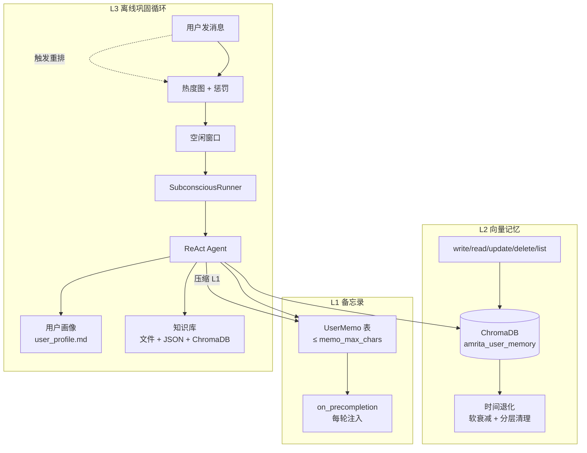
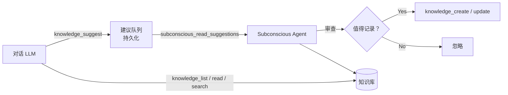

# 长期记忆与知识库

## 概述

长期记忆由 **`amrita_plugin_memory`** 插件提供 [](https://pypi.org/project/amrita-plugin-memory/)，采用三层记忆模型：

| 层 | 名称 | 载体 | 何时使用 |
| --- | --- | --- | --- |
| L1 | 备忘录 | 插件自有 ORM 表（每个 uni_id 一行） | 恒常注入，每轮都在 system prompt 里 |
| L2 | 检索记忆 | ChromaDB（文档 + 可选向量） | LLM 按需检索、写入、更新 |
| L3 | 离线巩固循环（DMN） | 后台 ReAct Agent | 空闲窗口到达时整理记忆、画像与知识 |

L1 是一段千字内的用户元信息，放身份、稳定偏好、用户指定的工具调用模式；L2 是长尾事实库，按需检索，默认关键词与向量混合，不配嵌入模型时退为纯关键词；L3 在用户作息里的冷门时段跑一轮后台整理，做去重、压缩、画像精炼和知识沉淀。

## 安装

```bash
uv run ambot plugin add amrita_plugin_memory
```

前置依赖：

- Python **3.11–3.13**（插件元数据要求 `<3.14,>=3.11`，Python 3.10 环境装不上）
- AmritaBot 1.10+
- Ollama 或 OpenAI 兼容的嵌入服务（**可选**，插件不自带嵌入模型；不配则 L2 只走关键词检索）
- ChromaDB（本地模式随依赖安装，也可连远程服务）

安装后插件会写入 `pyproject.toml` 的 `[tool.amrita.plugins]`：

```toml
[tool.amrita]
plugins = ["amrita.plugin.chat", "amrita_plugin_memory"]
```

## 快速开始

### 1. 配置向量库与嵌入服务

向量库是必需的。嵌入服务可以不配，此时 L2 只用关键词检索：

```env
VECTOR_DB_TYPE=local
EMBEDDING_MODEL_URL=http://127.0.0.1:11434
EMBEDDING_MODEL_NAME=auto
EMBEDDING_PROCTOL=ollama-embed
```

| 环境变量 | 默认值 | 说明 |
| --- | --- | --- |
| `VECTOR_DB_TYPE` | `local` | `local` 本地持久化 / `remote` 远程 ChromaDB |
| `VECTOR_DB_SERVER` | `127.0.0.1` | 远程地址（仅 `remote`） |
| `VECTOR_DB_PORT` | `8000` | 远程端口（仅 `remote`） |
| `VECTOR_DB_SERVER_SSL` | `false` | 远程是否使用 SSL（仅 `remote`） |
| `VECTOR_DB_REMOTE_HEADERS` | `{}` | 远程请求头（仅 `remote`） |
| `VECTOR_DB_TENANT` | `default` | 远程租户 |
| `VECTOR_DB_DATABASE` | `default` | 远程数据库 |
| `EMBEDDING_ENABLED` | 空（自动尝试） | 设为 `false` 则完全不调用嵌入服务 |
| `EMBEDDING_MODEL_URL` | `http://127.0.0.1:11434` | 嵌入模型地址 |
| `EMBEDDING_MODEL_NAME` | `auto` | 嵌入模型名称 |
| `EMBEDDING_PROCTOL` | `ollama-embed` | `openai` / `ollama-embed` |
| `EMBEDDING_MODEL_API_KEY` | 空 | 嵌入服务 API Key（可选） |
| `EMBED_CHECK_ON_STARTUP` | `true` | 启动时校验嵌入指纹 |
| `EMBED_MISMATCH_POLICY` | `ask` | 模型变更时 `ask` / `auto` / `never` |
| `REEMBED_BATCH_SIZE` | `64` | 重映射每批条数 |
| `REEMBED_BACKUP_KEEP` | `3` | 保留备份份数 |

### 2. L1 与 L2 开箱可用

无需额外配置。LLM 会在需要时调用 `write_memory` / `read_memory` / `update_memo` 等工具；L1 备忘录一旦写入，此后每轮对话都会自动注入。没有嵌入服务时 L2 退到关键词检索，增删改查照常。

### 3. 开启 L3 离线巩固循环

编辑 `config/amrita_plugin_memory/config.toml`：

```toml
[subconscious]
enabled = true
target_user_id = "你的QQ号"
```

默认按作息热度图挑空闲窗口，不再固定 30 分钟。第一次运行时热度图还是空的，会落在 `idle_target_hour` 指定的固定窗口。

如需允许 Agent 主动发私聊消息：

```toml
[subconscious]
allow_send_to_user = true
```

关闭全局知识库以节省 token：

```toml
[subconscious]
enable_knowledge = false
```

> L3 专为**单用户个人助理**场景设计，单轮可能消耗数万 tokens。多用户部署或对成本敏感时保持 `enabled = false`。知识库当前依赖 L3，`enabled = false` 时知识库也会自动禁用。

### 4. 验证

```bash
uv run ambot memory status
```

观察日志中的 `[Subconscious]` / `[Memory]` 前缀：

```text
[Subconscious] Starting for user=你的QQ号
[Subconscious] Idle — waiting for user chat to trigger first run
```

用户发消息后会先看到 `Rescheduled: penalty=#1, ...`，里面带着选中的窗口（星期几、起止时刻、长度、分层、放宽次数）。时间到了才有 `Cycle start`。

## 三层架构



## L1 备忘录

`memo_max_chars`（默认 1000）是硬上限。主力写入方式是整篇替换：读当前 memo、融合新事实、输出全文，服务端校验长度后落库。超长时工具直接拒绝并返回当前字数，由 LLM 自己压缩重试。

- 存什么：身份、稳定偏好、用户明确要求的工具调用模式；
- 不存什么：具体事件与项目细节放 L2；祈使句规则应写 `extra_prompt`，插件不读也不写它；
- 注入范围：私聊注入个人 memo；群聊只注入群 memo，不注入群成员的个人 memo；空 memo 不注入；
- 表结构：`amrita_plugin_memory_user_memo`，主键为框架 `uni_id`，个人与群各占一行。

工具三个：

| 工具 | 作用 |
| --- | --- |
| `read_memo` | 读取当前作用域备忘录全文 |
| `append_memo` | 在末尾追加一段 |
| `update_memo` | 整篇替换（推荐用法） |

## L2 检索记忆

`scope` 表达语义，分区键跟随 Amrita 的 `make_uni_id`（旧版 `user_{qq}`，新版 `QQPlatform_Private_{qq}`）。插件不硬编码键格式，升级后自动跟随，存量 Key 由启动检查幂等迁移。

| `scope` | 含义 | 可用场景 |
| --- | --- | --- |
| `user` | 个人专属，群聊私聊互通 | 任意 |
| `group` | 群共享，群内所有人可见 | 仅群聊 |

每条记忆带 `user_id` / `scope` / `tags` / `importance` / `created_at`。`read_memory` 支持 `top_k` 与 `importance` 过滤。

### 检索模式

`read_memory` 的 `mode` 参数由 LLM 按需选择，`vector_weight` 只在 `hybrid` 下生效：

| `mode` | 行为 |
| --- | --- |
| `auto` | 有可用嵌入模型时用 `hybrid`，否则退到 `keyword`（默认） |
| `hybrid` | 关键词 BM25 与向量各自排序，按 `vector_weight`（默认 0.6）加权 RRF 融合 |
| `keyword` | 只走关键词，不调用嵌入服务 |
| `vector` | 只走向量；没有模型时直接报错，不静默换语义 |

关键词一路不依赖分词库：英文按词、中文按二元组切分后在本地算 BM25。嵌入模型不可用时，
嵌入请求失败一次就会被记为不可用并缓存，不会每次读写都去撞一个连不上的服务；写入改用占位向量占住 Chroma 的行
（宽度沿用库里已有向量），检索完全不走向量路径。

### 时间退化

分两段，均由 `[decay].enabled` 控制：

1. **软衰减**：检索期按「相关度 × `max(0.5^(age/half_life), floor)`」重排后截回 `top_k`。相关度在向量模式下来自距离映射（`1/(1+d)`），混合模式下来自融合分；只影响排序，不删除数据；
2. **分层清理**：按 importance 的寿命阈值扫描，超龄先降级，降到 `low` 仍超龄才删除。

`low` 层默认 7 天，`high` 层默认 90 天，`medium` 取几何中值。清理任务按 `sweep_interval_hours` 周期执行。

## L3 离线巩固循环（DMN）

L3 复用 Core 的 `REACT_ONLY`，`SubconsciousRunner` 只注入隔离的 `SubconsciousBackend` 与 `ReActAgentStrategy`。每轮第一件事必须调 `subconscious_get_context`（精确时间、距上轮间隔、上轮摘要、待审建议、库规模），system prompt 因此只放不变量，同一天内逐字节一致，能吃到 provider 的前缀缓存。

### 触发与空闲窗口

<!-- TODO: 补一张 /memory heatmap 的作息热度图与下次运行时间截图。 -->

用户发消息就给所在时槽加一次热度、`penalty + 1`、重新挑选窗口。默认按 **7 天 × 12 槽**（每槽 2 小时）的热度图找冷段：

- `penalty` 的含义是「要求多长的冷段」，不是延迟分钟数；
- 冷段不足时按 `idle_max_relax_steps` 逐次减半放宽；
- 窗口起止留 `idle_buffer_minutes` 安全缓冲，并扣掉 `idle_run_estimate_minutes` 的预计耗时；
- 没有历史时落在 `idle_target_hour` 的固定窗口。

关闭 `use_idle_window_planner` 后回退到旧的固定指数退避方案，此时 `rethink_base_delay_minutes` / `rethink_penalty_multiplier` / `rethink_max_delay_minutes` 才生效。

### 整理职责

- 去重合并、重要性校准与标签统一；
- 画像精炼与知识沉淀；
- 临近上限时压缩 L1，把细节下放到 L2，只留指针；
- 读取归档 sessions 做跨会话摘要。

### 调度可靠性

- 待执行任务的触发时刻随状态落盘，重启后补排；停机期间错过的窗口一分钟内补跑；
- `misfire_grace_time` 置空，事件循环被卡住也不会静默丢掉这次运行；
- 单轮失败按 30 分钟间隔最多重试 3 次，用户再发消息会重置重试计数；
- `penalty` 与热度图一起存在 `SubconsciousState.payload`，重启后继续使用。

## 全局知识库

知识库是 L2 与 L3 共享的资源。读取操作对对话 LLM 开放，但受权限控制；写入只发生在 L3。



每条知识由三部分组成：

- **Markdown 文件**：第一行 `# 标题`，随后摘要文本，`---` 之后是正文；
- **JSON 索引**：`knowledge_index.json`，记录 `kid` / `title` / `summary` 等；
- **ChromaDB**：`{kid → embedding(summary)}`，只对摘要做向量化。

LLM 只需传 `title` / `summary` / `body`，分隔符由框架维护。`knowledge_read` 支持 `start_line` / `end_line`，长条目可以分段读。

启动时 `validate_on_startup` 会计算三方 ID 集合差集，自动修复孤文件、孤索引、缺向量、悬空向量四种不一致。

### 读取权限

`knowledge_list` / `knowledge_read` / `knowledge_search` 需要 LP 权限节点 `memory.knowledge`，`lp.admin` 与 `.env` 里的超级用户始终持有。未授权时返回错误 JSON，不返回任何知识内容。

`read_profile` 走另一条口径：只对 `subconscious.target_user_id` 开放，且只能读目标用户自己的画像，不占用权限节点。画像写入只发生在 L3 内部。

## 工具参考

### 表层工具

| 工具 | 参数 |
| --- | --- |
| `write_memory` | content, tags, importance(enum), scope(enum) |
| `read_memory` | query, top_k(5), importance?, scope(enum) |
| `update_memory` | id, scope, content?, tags?, importance? |
| `delete_memory` | id, scope |
| `list_memory` | limit(10, 上限 50), offset, scope |
| `read_memo` | — |
| `append_memo` | content |
| `update_memo` | content |
| `knowledge_list` | — |
| `knowledge_read` | kid, start_line?, end_line? |
| `knowledge_search` | query, top_k? |
| `knowledge_suggest` | action, title, summary, body, reason |
| `read_profile` | start_line?, end_line? |

### 巩固循环工具

`rethinking/tools.py` 中注册了 21 个 handler，挂在隔离的 `_SUBCONSCIOUS_TOOLS` 上，不污染全局工具管理器。

| 工具 | 用途 |
| --- | --- |
| `subconscious_read_memory` | 语义检索 |
| `subconscious_write_memory` | 写入新记忆 |
| `subconscious_update_memory` | 更新指定 ID |
| `subconscious_delete_memory` | 删除指定 ID |
| `subconscious_list_memory` | 列出记忆 |
| `subconscious_duplicate_helper` | 去重辅助 |
| `subconscious_get_memory_stats` | 总量 / 重要性 / 标签分布 |
| `subconscious_get_context` | 时间、间隔、上轮摘要、待审建议、库规模 |
| `subconscious_read_chat_context` | 读取最近聊天记录 |
| `subconscious_read_sessions` | 读取归档 sessions |
| `subconscious_iter_stop` | 结束本轮 |
| `subconscious_send_to_user` | 主动发消息 |
| `subconscious_knowledge_list` | 列出知识 |
| `subconscious_knowledge_read` | 读取知识（支持行窗口） |
| `subconscious_knowledge_search` | 语义搜索知识 |
| `subconscious_knowledge_create` | 创建知识 |
| `subconscious_knowledge_update` | 更新知识 |
| `subconscious_knowledge_delete` | 删除知识 |
| `subconscious_read_suggestions` | 读取并清空待审建议 |
| `subconscious_get_profile` | 读取画像（行窗口） |
| `subconscious_update_profile` | 增量更新画像 |

## 命令参考

### 用户命令 `/memory`

| 命令 | 作用 |
| --- | --- |
| `/memory user list [页码]` | 分页列出个人记忆，每页 10 条 |
| `/memory user search <关键词>` | 搜索个人记忆，top_k=10 |
| `/memory user delete <ID>` | 删除个人记忆 |
| `/memory group list [页码]` | 列出群共享记忆 |
| `/memory group search <关键词>` | 搜索群共享记忆 |
| `/memory group delete <ID>` | 删除群共享记忆（仅管理员 / 群主） |
| `/memory memo` | 以合并转发查看当前作用域备忘录 |
| `/memory dmn` | 立即触发一轮巩固循环（隐藏，需管理员） |
| `/memory heatmap` | 作息热度图与下次运行时间（隐藏，需管理员） |

`dmn` 与 `heatmap` 不进菜单与 usage 提示，鉴权顺序为超级用户白名单、`lp.admin`。`dmn` 还要求 `subconscious.enabled = true` 且已配置 `target_user_id`。兼容旧格式 `/memory list`，默认按个人范围执行。

### 运维命令 `ambot memory`

| 命令 | 作用 |
| --- | --- |
| `ambot memory status` | 嵌入指纹、记忆分布、分区键版本、备份列表 |
| `ambot memory reindex [--yes]` | 强制全量重映射并写新指纹 |
| `ambot memory migrate-keys [--dry-run]` | 迁移分区键到当前 `uni_id` 格式 |
| `ambot memory reset-fingerprint` | 只写指纹、不重嵌入（逃生舱） |
| `ambot memory backup list` | 列出备份 |
| `ambot memory backup create` | 手动备份 |
| `ambot memory backup restore <file>` | 从备份恢复，用当前模型重新嵌入 |

这些命令会先设置 `EMBED_CHECK_ON_STARTUP=false` 再加载插件，避免启动检查在 CLI 里触发交互。`ambot memory` 命令组需要本地 `ambot-inlinectl` 版本包含该实现，`ambot` 过旧时先升级。

## 配置参考

`config/amrita_plugin_memory/config.toml`：

```toml
# L2
per_session_memory_limit = 100
memo_max_chars = 1000

[decay]
enabled = true
short_term_days = 7
long_term_days = 90
half_life_days = 30.0
importance_boost = 1.0
overfetch = 3
score_floor = 0.05
sweep_enabled = true
sweep_interval_hours = 24
[retrieval]
default_mode = "auto"
vector_weight = 0.6
keyword_candidate_limit = 2000

[subconscious]
enabled = false
target_user_id = ""
allowed_tools = []
max_iterations = 10
loop_detect_threshold = 3
use_idle_window_planner = true
idle_timezone = "Asia/Shanghai"
idle_target_hour = 3
idle_base_slots = 3
idle_max_slots = 6
enable_memory_compress = true
allow_send_to_user = false
memory_warn_threshold = 100
max_abstracts = 5
knowledge_max_chars = 10000
knowledge_collection_name = "amrita_global_knowledge"
enable_knowledge = true
```

| 配置项 | 默认值 | 说明 |
| --- | --- | --- |
| `per_session_memory_limit` | `100` | 单个分区（uni_id）的记忆条数上限 |
| `memo_max_chars` | `1000` | L1 备忘录字数硬上限（100–10000） |
| `retrieval.default_mode` | `auto` | 默认检索模式，可被工具 `mode` 覆盖 |
| `retrieval.vector_weight` | `0.6` | `hybrid` 下向量权重，其余归关键词 |
| `retrieval.keyword_candidate_limit` | `2000` | 关键词检索单次扫描上限 |
| `decay.enabled` | `true` | 时间退化总开关 |
| `decay.short_term_days` | `7` | `low` 层寿命阈值 |
| `decay.long_term_days` | `90` | `high` 层寿命阈值 |
| `decay.half_life_days` | `30.0` | 软衰减基础半衰期 |
| `decay.importance_boost` | `1.0` | high 半衰期为 `1+2·boost` 倍 |
| `decay.sweep_enabled` | `true` | 分层清理开关 |
| `subconscious.enabled` | `false` | 是否启用 L3 |
| `subconscious.target_user_id` | `""` | 目标用户，为空不启动 |
| `subconscious.allowed_tools` | `[]` | 额外工具，从全局工具池查找 |
| `subconscious.max_iterations` | `10` | 单轮 ReAct 最大步数（1–50） |
| `subconscious.loop_detect_threshold` | `3` | 连续重复工具调用阈值（2–10） |
| `subconscious.use_idle_window_planner` | `true` | 空闲窗口调度；关闭后回退固定延迟 |
| `subconscious.idle_timezone` | `Asia/Shanghai` | 热度图与窗口时区 |
| `subconscious.idle_target_hour` | `3` | 冷启动偏好触发小时 |
| `subconscious.idle_base_slots` | `3` | 首次计划要求的最短冷段（1 槽=2h） |
| `subconscious.idle_max_slots` | `6` | 冷段要求封顶 |
| `subconscious.allow_send_to_user` | `false` | 允许主动私聊 |
| `subconscious.memory_warn_threshold` | `100` | 超量时注入压缩提示 |
| `subconscious.max_abstracts` | `5` | 摘要滑动窗口（1–20） |
| `subconscious.knowledge_max_chars` | `10000` | 单条知识正文上限 |
| `subconscious.enable_knowledge` | `true` | 知识库开关 |

空闲窗口调度还有十余个调参项（各层衰减常数、冷槽阈值、收缩强度、buffer 与预估耗时），默认值见 `config.py`，一般不需要改。

## 持久化与升级

| 存储 | 技术 | 内容 |
| --- | --- | --- |
| L1 备忘录 | `UserMemo` 表 | 常驻用户元信息 |
| 循环状态 | `SubconsciousState` 表 | `total_runs`、摘要、待审建议、penalty、热度图 |
| Session 摘要缓存 | `LRUCache[int, str]`（128 条） | session DB id → 摘要 |
| L2 记忆 | ChromaDB `amrita_user_memory` | 文档、向量（纯关键词部署为占位向量）、元数据、嵌入指纹 |
| 用户画像 | `data/amrita_plugin_memory/user_profile.md` | `summary---body` 格式 |
| 知识库 | `data/.../knowledge/` + JSON + ChromaDB | 三方同步 |
| Token 统计 | `InsightsModel` | 全局 prompt/completion token |

### 嵌入模型变更

向量只在同一模型下可比。插件在集合 metadata 里记录 `sha256(protocol|model|base_url)`，每次启动校验。不一致时按 `EMBED_MISMATCH_POLICY`：

- `auto`：备份后删集合重建、全量重嵌；
- `ask`：交互确认，非 TTY 环境只告警；
- `never`：只告警。

指纹只看配置，同名模型被服务端换掉检测不到，用 `ambot memory reindex` 手动处理。嵌入服务不可用时跳过重映射，不挡启动；`EMBEDDING_ENABLED=false` 时 `reindex` 直接拒绝。

### 数据库迁移

插件自带两条 ORM 迁移：`21f55abc2b90` 建 `UserMemo`，`6004d221a7de` 建 `SubconsciousState`，`depends_on` 指向 `nonebot_plugin_amrita` 的初始迁移。升级插件后执行：

```bash
uv run ambot orm upgrade
```

## 注意事项

- L3 每轮可能消耗数万 tokens，按成本预算决定是否开启；
- 表层记忆与 L3 共享同一个 ChromaDB（`data/amrita_plugin_memory/vector_db.chroma`）；
- 知识库写入仅限 L3，表层只能通过 `knowledge_suggest` 提交建议；
- 依赖 `nonebot_plugin_apscheduler`、`nonebot_plugin_localstore`、`nonebot_plugin_orm`；
- 旧版 penalty 语义是「被推迟的次数」，新版是「要求的冷段长度」，不可换算。启用空闲规划时若检测到 payload 里没有 `idle_planner`，会清零一次并打日志。
