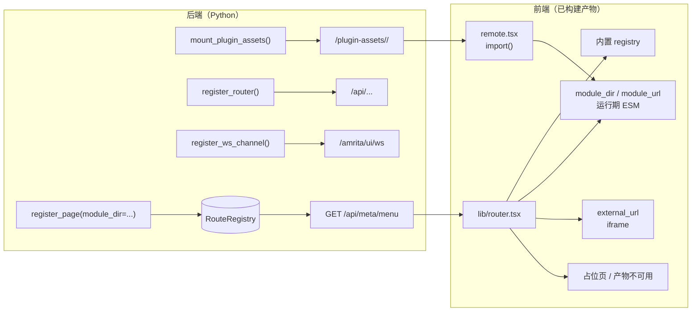

# 页面扩展开发

Amrita 的 WebUI 是**前端 SPA**（React + Vite + Tailwind v4，位于 `frontend/`），后端只负责菜单/路由元数据与 JSON 数据 API，不渲染服务端模板。

第三方插件可以带一份自己构建的 ESM 产物接入侧边栏，**不需要重新构建宿主前端**。1.18 起推荐用 `module_dir` + `mount_plugin_assets`，构建侧使用 npm 上的 `@amrita-constant/webui-plugin-kit`。

::: tip 相关阅读

- [前端 API](./frontend-api) —— REST 接口与 WebSocket 协议
- [UI 组件库](./components) —— 宿主与插件共用的组件包
- [扩展点与事件钩子](../../developer/extension-points#webui-扩展) —— 后端扩展点总览

:::

## 架构概览



后端 `register_page()` 注册元数据 → `GET /api/meta/menu` 返回 → 前端按来源解析组件。`module_dir` 的 URL、mtime 版本参数和可用性检查都由宿主完成。

## 页面来源与优先级

前端按以下顺序解析：

| 优先级 | 来源 | 需要重新构建宿主？ | 说明 |
| --- | --- | --- | --- |
| 1 | 前端内置 `registry` | 是 | Amrita 自带页面（`frontend/src/pages/registry.tsx`） |
| 2 | `module_dir` | **否** | 推荐。插件给出单层产物名，宿主解析为 `/plugin-assets/<name>/index.js?v=<mtime>` |
| 3 | `module_url` | **否** | 1.10 起的旧接口，完整 URL；宿主无法校验可用性，仅作兼容 |
| 4 | `external_url` | **否** | `<iframe>` 嵌入的独立页面 |
| 5 | 都没有 | — | 渲染「页面未接入」占位页 |

`module_dir` 与 `module_url` 只能二选一，同时传会抛 `ValueError`。

## 注册页面

```python
from pathlib import Path

from amrita.plugins.webui.API import register_page
from amrita.plugins.webui.service.plugin_assets import mount_plugin_assets

# 1. 在插件 import 期挂载产物（产物随 Python 包分发）
mount_plugin_assets("my_plugin", Path(__file__).parent / "webui")

# 2. 注册页面元数据
register_page(
    path="/myplugin/dashboard",   # FastAPI 风格路径，支持 {param}
    page_name="我的面板",
    category="我的插件",           # __HIDDEN__ 表示不进侧边栏
    icon="activity",              # lucide 图标名
    module_dir="my_plugin",       # 与 mount_plugin_assets 的名字一致
)
```

也可以用装饰器形式（`on_page`）。被装饰的函数体不会执行，保留它只是让声明贴近旧写法：

```python
from amrita.plugins.webui.API import on_page


@on_page("/myplugin/dashboard", "我的面板", category="我的插件", module_dir="my_plugin")
def _page() -> None:
    pass
```

::: warning 必须在插件 import 期完成

页面元数据和产物挂载都要在插件加载时登记。SPA 的 catch-all 路由挂在 `driver.on_startup`，晚于它挂载的静态目录或路由会被抢先匹配，表现为菜单不出现或接口永远返回 `index.html`。

:::

## 构建插件前端

<!-- TODO: 补一张第三方插件通过 module_dir 加载后的实际页面截图（含侧边栏入口与插件页面），待有示例插件后统一补拍。 -->

### 1. 安装构建套件

```bash
bun add -d @amrita-constant/webui-plugin-kit @amrita-constant/ambot-ui
```

`@amrita-constant/ambot-ui` 提供 UI 组件的类型与组件清单，构建器需要读取它。宿主侧要求 AmritaBot 1.18+。

### 2. 配置 `amrita-plugin.json`

在插件项目根目录放一个构建配置：

```json
{
  "entry": "src/index.tsx",
  "outdir": "webui",
  "assets": ["src/index.css"]
}
```

`outdir` 建议指向随 Python 包分发的目录（例如插件包内的 `webui/`）。如果只是本地开发，也可以输出到宿主的 `static/plugins/<name>/`，但那是宿主构建产物目录，`scripts/cleanup.sh` 会清空它。

### 3. 构建

```bash
bunx amrita-plugin-build
```

产物入口固定为 `index.js`，末尾会追加 `export const amritaHostContract = 3`。宿主加载时比对契约版本，不一致会在控制台点名，但不会拦截加载。

构建器会把下列依赖解析成 `window.__AMRITA_HOST__` 的引用，避免插件打进第二份 React：

| 插件里的 import | 宿主字段 |
| --- | --- |
| `react` | `React` |
| `react-dom` | `ReactDOM` |
| `react-dom/client` | `ReactDOMClient` |
| `react/jsx-runtime` / `jsx-dev-runtime` | 由 `React.createElement` 现造 |
| `react-router-dom` | `ReactRouterDOM` |
| `@tanstack/react-query` | `ReactQuery` |
| `lucide-react` | `LucideReact` |
| `@amrita-constant/webui-plugin-kit/ui` | `UI`（`@amrita-constant/ambot-ui` 组件） |

`notifyUnauthorized` 也在宿主全局里，插件请求收到 401 时可调用它统一退回登录页。

### 4. 编写页面

```tsx
import { useEffect, useState } from "react";
import { Button, Card, CardContent } from "@amrita-constant/webui-plugin-kit/ui";
import { injectCss, pluginApi } from "@amrita-constant/webui-plugin-kit/runtime";

// 插件自带样式：宿主 Tailwind 不会扫描插件源码，未注入的类不会生效
injectCss(new URL("./index.css", import.meta.url).href, "my-plugin-css");

export default function Page() {
  const [rows, setRows] = useState<{ name: string }[]>([]);

  useEffect(() => {
    pluginApi.get("/api/myplugin/list").then(setRows);
  }, []);

  return (
    <Card>
      <CardContent className="space-y-4">
        {rows.map((row) => (
          <div key={row.name}>{row.name}</div>
        ))}
        <Button onClick={() => pluginApi.post("/api/myplugin/reload")}>
          重新加载
        </Button>
      </CardContent>
    </Card>
  );
}
```

### 5. 样式注意

宿主的主 CSS 由 Tailwind 扫描宿主源码生成，**只包含宿主源码里出现过的类**。插件里写 `bg-fuchsia-700`、`ring-8`、`columns-3`、`prose` 这类宿主从未使用的类，会静默失效。

两条路：

1. 只用宿主已有的设计 token（`bg-card`、`text-muted-foreground`、`rounded-xl` 等）；
2. 自带 CSS，用 `injectCss`（链接）或 `injectStyleText`（内联）注入。推荐作为兜底，避免依赖宿主构建细节。

## 方式一：iframe 页面

用任意技术栈写一个独立页面，由插件自己的路由提供 HTML：

```python
from fastapi import APIRouter
from fastapi.responses import HTMLResponse
from amrita.plugins.webui.API import register_page, register_router

router = APIRouter()


@router.get("/page")
async def page() -> HTMLResponse:
    return HTMLResponse("<h1>Hello from my plugin</h1>")


register_router(router, prefix="/myplugin", tags=["myplugin"])
register_page("/myplugin/dashboard", "我的面板", external_url="/myplugin/page")
```

**优点**：技术栈自由、样式与宿主天然隔离、无需构建集成。

**注意**：无法直接复用宿主 React 组件与 Tailwind 主题；登录态不会自动共享，需要时用 `postMessage` 从宿主传一次性 token。

## 方式二：旧版 `module_url`

`module_url` 仍是可用接口，适合已经发布、暂时不想迁移的插件：

```python
register_page(
    "/myplugin/dashboard",
    "我的面板",
    module_url="/static/plugins/myplugin/index.js",
)
```

宿主会原样下发，不做可用性检查，也不会附加版本参数。模块同样需要 `export default` 一个 React 组件，并从 `window.__AMRITA_HOST__` 取运行时依赖。新插件请直接用 `module_dir`。

## 挂载数据接口

```python
from fastapi import APIRouter
from amrita.plugins.webui.API import register_router

router = APIRouter()


@router.get("/stats")
async def stats() -> dict[str, int]:
    return {"count": 1}


register_router(router, prefix="/api/myplugin", tags=["myplugin"])
```

路由受 WebUI 登录中间件保护：

- `/api` 前缀：未登录返回 401 JSON
- 其他前缀：未登录 302 到登录页
- `/static` 与 `/plugin-assets` 是公开静态命名空间，插件数据接口仍应走 `/api`

## 推送实时数据

```python
from amrita.plugins.webui.API import broadcast_ws, register_ws_channel


async def snapshot() -> dict:
    return {"channel": "myplugin", "data": {"ready": True}}


# snapshot 可为同步或异步；返回 None 表示本次无快照
register_ws_channel("myplugin", snapshot)
await broadcast_ws("myplugin", {"ready": False})
```

客户端订阅：

```json
{ "action": "subscribe", "channels": ["myplugin"] }
```

未声明的频道名会被 `/amrita/ui/ws` 忽略。内置频道为 `system`、`bot`、`logs`。

## 完整示例

```python
from pathlib import Path

from fastapi import APIRouter
from amrita.plugins.webui.API import (
    broadcast_ws,
    register_page,
    register_router,
    register_ws_channel,
)
from amrita.plugins.webui.service.plugin_assets import mount_plugin_assets

router = APIRouter()


@router.get("/stats")
async def stats() -> dict[str, int]:
    return {"count": 42}


async def snapshot() -> dict:
    return {"channel": "myplugin", "data": {"ready": True}}


def setup() -> None:
    # import 期完成挂载与注册
    mount_plugin_assets("my_plugin", Path(__file__).parent / "webui")
    register_router(router, prefix="/api/myplugin", tags=["myplugin"])
    register_ws_channel("myplugin", snapshot)
    register_page(
        "/myplugin/dashboard",
        "我的面板",
        category="我的插件",
        icon="activity",
        module_dir="my_plugin",
    )
```

## 前端开发（修改 Amrita 自带页面）

只有改动内置页面时才需要参与宿主前端构建：

```bash
git submodule update --init --recursive   # frontend/packages/ui 是子模块
cd frontend
bun install
bun run dev      # Vite 开发服务器，带 /api 与 /amrita 代理
bun run build    # 构建并替换 amrita/plugins/webui/service/static/
```

新增内置页面需要在 `frontend/src/pages/registry.tsx` 登记，并在后端 `route/menu.py` 的 `_CORE_ROUTES` 中补菜单项。

## 已知限制

- **同 realm，无沙箱**：插件与宿主共享 `window`，能访问宿主上下文，按可信来源对待。
- **模块缓存**：前端会永久缓存已加载的插件模块，插件禁用后旧模块仍在内存，刷新页面才会清掉。
- **入口文件名固定** `index.js`。
- **`module_url` 无校验**：这是旧接口的固有限制，新插件用 `module_dir`。
