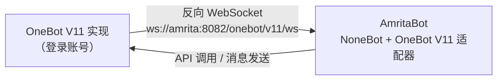

# 连接到 OneBot V11 实现

## 概述

本文档介绍如何把已部署的 AmritaBot 接到任意支持 **OneBot V11** 协议的实现上。具体实现的名字、界面与配置项各不相同，但连接参数是一致的：地址、端口、路径、Token。

## 前置条件

- 已完成 [安装 AmritaBot](./quick-start.md)
- 已完成 [部署 AmritaBot](./installation.md)
- 已按 [配置参考](./configuration.md) 配好 `.env`
- 有一个支持 OneBot V11 的协议实现，并已登录要使用的账号

## 连接拓扑

AmritaBot 作为 OneBot V11 的服务端，协议实现作为客户端主动连上来。这种方式通常叫「反向 WebSocket」。



## 第一步：启动 AmritaBot

```bash
uv run ambot run
```

启动日志会给出监听地址，例如：

```text
2026-01-16 20:42:11 | INFO | uvicorn:startup:62 | Application startup complete.
2026-01-16 20:42:11 | INFO | uvicorn:_log_started_message:216 | Uvicorn running on http://127.0.0.1:8082
```

记下实际的主机与端口。下文用 `127.0.0.1:8082` 举例，请替换成你的部署地址。

## 第二步：配置协议实现

在协议实现的网络配置里新建一个 **反向 WebSocket**（有的实现叫「WebSocket 客户端」）连接：

| 配置项 | 值 |
| --- | --- |
| 连接类型 | 反向 WebSocket / WebSocket 客户端 |
| 连接地址 | `ws://127.0.0.1:8082/onebot/v11/ws` |
| Access Token | 与 AmritaBot 的 `ONEBOT_ACCESS_TOKEN` 完全一致 |
| 重连间隔 | 3–5 秒（按实现默认值即可） |
| 事件推送 | 开启群消息、私聊消息、群成员变动等需要的事件 |

<!-- TODO: 通用反向 WebSocket 配置示意图占位（隐去具体实现名称），后续统一补图 -->

几个容易出错的点：

- **路径不能省**：末尾必须是 `/onebot/v11/ws`，只写 `ws://host:port` 会 404。
- **协议不能写错**：AmritaBot 这一侧是 `ws://`；只有在前面放了 TLS 反向代理时才用 `wss://`。
- **Token 要一致**：AmritaBot 的 `ONEBOT_ACCESS_TOKEN` 与协议实现里的 Token 必须逐字符相同，区分大小写。
- **不要填反方向**：是协议实现去连 AmritaBot，不是 AmritaBot 去连协议实现。

如果协议实现与 AmritaBot 不在同一台机器，把 `127.0.0.1` 换成 AmritaBot 的内网地址，并确认防火墙放行对应端口。

## 第三步：验证连接

连接建立后，AmritaBot 日志会出现 Bot 上线与连接建立相关记录。随后：

1. 私聊 Bot 发送 `/amrita`，应返回版本与运行信息；
2. 在群里 @Bot 或按配置的关键词触发一次对话；
3. 在 WebUI 的「Bot 状态」页确认连接状态为在线，「实时日志」里能看到事件。

如果 Bot 显示离线，按下一节的顺序排查。

## 故障排除

| 现象 | 常见原因 |
| --- | --- |
| 连接被拒绝（403） | Token 不一致；协议实现填了 Token，AmritaBot 没配，或反过来 |
| 404 / 一直重连 | URL 路径少了 `/onebot/v11/ws`，或端口写错 |
| 能连上但收不到消息 | 协议实现没有开启对应事件推送；账号未登录；群消息需要 @ 或关键词才触发 |
| 容器之间连不上 | 不要用 `127.0.0.1`，改用容器网络别名或宿主机内网 IP，并确认端口映射 |
| 连接很快断开 | 检查心跳与重连配置、代理超时、Token 是否在重连时丢失 |
| 日志出现鉴权失败 | `ONEBOT_ACCESS_TOKEN` 与协议实现的 Token 不一致，或环境变量没有真正加载 |

排查顺序建议：先看 AmritaBot 启动日志确认端口，再看协议实现的连接日志确认请求 URL，最后核对 Token。三步里通常能定位到问题。

## 安全建议

- 不要将 WebUI 暴露到公网。WebUI 的认证只适合内网或受控网络。
- 为 OneBot V11 连接配置一个足够长的 `ONEBOT_ACCESS_TOKEN`，不要留空。
- 跨公网连接时，在 AmritaBot 前放一层 TLS 反向代理，使用 `wss://`，并限制来源 IP。
- 不要把协议实现的管理端口与 AmritaBot 的端口直接暴露在公网。
